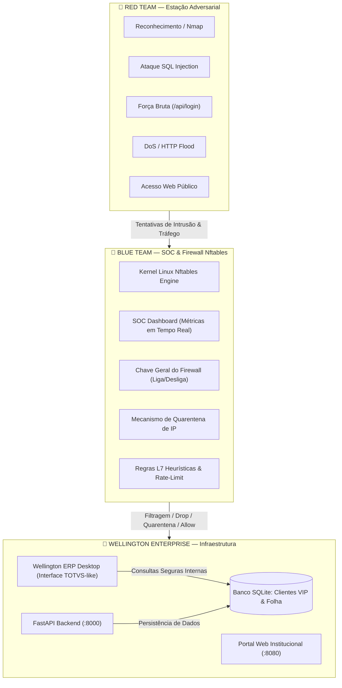

# 🛡️ Wellington CyberLab — Laboratório Integrado de Cibersegurança & Defesa Ativa


---

## 🎓 Contexto Acadêmico & Finalidade de Estudo

O **Wellington CyberLab** é um ecossistema prático desenvolvido como **trabalho acadêmico universitário** para os cursos de **Ciência da Computação, Engenharia de Software e Segurança da Informação**, voltado às disciplinas de:
- **Segurança da Informação e Defesa Cibernética**
- **Redes de Computadores e Protocolos de Comunicação**
- **Sistemas Operacionais e Administração de Redes Linux**

### 🎯 Objetivo do Projeto
Demonstrar, de maneira visual, interativa e em tempo real, o confronto clássico entre operações adversariais (**Red Team**) e mecanismos de detecção/mitigação (**Blue Team**), integrados a uma infraestrutura empresarial corporativa (**Wellington ERP Enterprise**).

O laboratório permite comprovar empiricamente a eficácia da estratégia de **Defesa em Profundidade (*Defense-in-Depth*)**, mostrando como regras de filtragem com estado (*Stateful Packet Inspection* via `nftables`), limitação de taxa (*Rate Limiting*), contenção de incidentes por quarentena e inspeção de payloads previnem vazamentos de dados confidenciais em sistemas de missão crítica.

---

## 🏛️ Arquitetura do Sistema (3 Pilares)



---

### 1. 🏢 Wellington ERP Enterprise (Ambiente Corporativo)
Simula um software ERP corporativo moderno de grande porte (estilo TOTVS / SAP):
- **Interface Gráfica Integrada:** Desenvolvida em Tkinter com design moderno escuro.
- **Módulos Críticos:**
  - **Autenticação de Usuários:** Perfis de acesso corporativo com privilégios diferenciados.
  - **Clientes VIP:** Carteira confidencial com CNPJ, limite de crédito e contratos estratégicos.
  - **Folha de Pagamento:** Salários confidenciais de diretoria, gerência e dados bancários de colaboradores.
- **Backend API (FastAPI):** Servidor HTTP de alta performance na porta `8000`, servindo tanto a API REST corporativa quanto o portal web institucional.

---

### 2. 🔵 Blue Team Defense Center (SOC & Firewall Nftables)
Centro de monitoramento defensivo e controle de segurança de rede:
- **Painel de Monitoramento SOC:** Exibe pacotes aceitos, pacotes bloqueados, taxa de requisições por segundo e alertas de intrusão com atualização em tempo real.
- **Motor Nftables no Kernel Linux:**
  - **Inspeção de Assinaturas (Anti-SQLi):** Bloqueio imediato (`HTTP 403 Forbidden`) de requisições com strings maliciosas (`UNION`, `SELECT`, `--`, `OR '1'='1'`).
  - **Proteção contra Força Bruta:** Monitoramento e corte de conexões abusivas no endpoint de login corporativo (`/api/login`).
  - **Proteção Anti-DDoS:** Regulação de conexões simultâneas e limitação de requisições (`HTTP 429 Too Many Requests`).
- **Contenção por Quarentena:** Isolamento instantâneo do endereço IP do atacante na tabela do kernel, cortando qualquer tráfego (inclusive acesso ao site público).
- **Chave Geral de Ativação/Desativação:** Permite desligar o firewall para demonstrar a vulnerabilidade da empresa sem defesas e ligá-lo novamente para comprovar a eficácia dos filtros.

---

### 3. 🔴 Red Team Adversary Station (Estação de Ataques)
Estação gráfica que automatiza os principais vetores de teste de intrusão:
- **Port Scanner:** Varredura rápida de portas TCP na rede-alvo.
- **Exploração SQL Injection:** Injeção de payloads para extração não autorizada da base de clientes e credenciais.
- **Ataque de Força Bruta ao Login:** Ataque de dicionário contra a tela de autenticação do sistema corporativo com captura e exibição da senha comprometida.
- **HTTP Flooder (DoS):** Disparo de rajadas volumétricas assíncronas para testar a resiliência do servidor e a resposta do rate-limiter.
- **Acesso ao Site Institucional:** Verificação instantânea da disponibilidade do serviço web público e checagem do status de bloqueio em quarentena.

---

## 📊 Matriz Comparativa: Firewall Ativo vs. Desativado

| Vetor de Teste | Firewall Nftables ATIVADO | Firewall Nftables DESATIVADO |
| :--- | :--- | :--- |
| **Acesso ao Site Institucional** | ✅ HTTP 200 OK | ✅ HTTP 200 OK |
| **Ataque SQL Injection** | 🛡️ **Bloqueado** (HTTP 403 Forbidden) | ❌ **Vazamento de Dados** (HTTP 200 OK) |
| **Força Bruta no Login** | 🛡️ **Barrado** (HTTP 403 / IP Limit) | ❌ **Senha Comprometida** (`AdminWellington2026!`) |
| **HTTP Flood (DoS)** | 🛡️ **Mitigado** (HTTP 429 Rate Limit) | ⚠️ **Saturação de Recursos** |
| **Sob Quarentena Total** | 🚫 **Acesso Totalmente Cortado** (Sem site) | 🚫 Requer ativação do módulo defensivo |

---

## 🚀 Instalação e Execução

### Pré-requisitos
- **Sistema Operacional:** Linux (Kernel com suporte a `nftables`).
- **Python:** 3.10 ou superior.
- **Privilégios:** Acesso `sudo` (necessário para manipulação das regras de firewall no kernel Linux).

### 1. Clonar o Repositório
```bash
git clone https://github.com/PabloPenna41/wellington-cyberlab.git
cd wellington-cyberlab
```

### 2. Instalar Dependências
```bash
# Dependências Python
pip install fastapi uvicorn requests

# Suporte ao Tkinter (se não instalado por padrão na sua distro)
# Ubuntu/Debian:
sudo apt install python3-tk nftables
# Arch Linux / CachyOS / Manjaro:
sudo pacman -S tk nftables
# Fedora:
sudo dnf install python3-tkinter nftables
```

### 3. Executar o Laboratório Completo
Basta executar o script mestre único na raiz do projeto:

```bash
# Execução direta com Python
python3 wellington.py

# Ou através do script Bash auxiliar
./wellington.sh
```

O script inicializa automaticamente:
1. O backend corporativo FastAPI em segundo plano (`http://127.0.0.1:8000`).
2. O subsistema de regras de firewall Nftables.
3. A janela do **Wellington ERP Enterprise**.
4. A janela do **Blue Team Defense Center (SOC)**.
5. A janela da **Red Team Adversary Station**.

### 4. Encerrar o Laboratório
Para fechar todas as aplicações e limpar as tabelas do firewall de forma limpa:
- Feche a janela principal do **Blue Team** ou do **ERP**;
- Ou execute diretamente:
```bash
./wellington-cyberlab/fechar_laboratorio.sh
```

---

## 🎬 Roteiro Sugerido para Apresentação Acadêmica

Para uma demonstração didática clara perante avaliadores e professores:

1. **Cenário 1 — Proteção Ativa (Padrão):**
   - Com o Firewall Ativo, clique em **"Executar Força Bruta"** no Red Team.
   - Observe que as tentativas são barradas com `HTTP 403` e a senha **não é descoberta**.
   - Clique em **"Injetar SQL"** e note o bloqueio imediato com aviso de segurança no painel do SOC.
2. **Cenário 2 — Quarentena de Ameaças:**
   - No Blue Team, insira o IP do atacante (`127.0.0.1`) e clique em **"Adicionar à Quarentena"**.
   - No Red Team, clique em **"Abrir Site Principal"** e observe que até o site público é cortado (`HTTP 403 / Connection Refused`).
   - Remova o IP da quarentena para restaurar o acesso básico.
3. **Cenário 3 — Demonstração da Vulnerabilidade (Firewall Desativado):**
   - No Blue Team, clique no botão **"Desativar Firewall (Modo Exposição)"**.
   - No Red Team, clique em **"Executar Força Bruta"**: o sistema quebrará a senha e exibirá as credenciais de Administrador na tela.
   - Clique em **"Injetar SQL"**: o banco responderá com `HTTP 200` expondo os registros confidenciais.
   - Clique novamente em **"Ativar Firewall"** no Blue Team para demonstrar o restabelecimento imediato da segurança corporativa.

---

## 📁 Estrutura de Diretórios

```text
wellington-cyberlab/
├── wellington.py                     # Script mestre único de execução multiplataforma
├── wellington.sh                     # Launcher bash com verificação de ambiente
├── .gitignore                        # Regras de exclusão de binários e cache
├── README.md                         # Documentação acadêmica e guia de uso
└── wellington-cyberlab/
    ├── backend/
    │   ├── api/
    │   │   └── main.py              # API FastAPI (autenticação, clientes, portal web)
    │   └── database/
    │       └── wellington_erp.db    # Banco SQLite didático (dados corporativos simulados)
    ├── firewall/
    │   ├── rules/
    │   │   ├── permanent_rules.nft  # Regras fundamentais do Nftables
    │   │   └── experimental_rules.nft # Regras L7 de rate-limiting e mitigação de exploits
    │   └── scripts/
    │       ├── setup_phase1.sh      # Provisionamento e carga de regras
    │       └── toggle_experimental.sh # Script de ativação/desativação e quarentena
    ├── gui/
    │   ├── control_center.py        # Blue Team Defense Center & SOC Dashboard
    │   ├── red_team_station.py      # Red Team Adversary Station
    │   └── wellington_erp_app.py    # Wellington ERP Enterprise (Interface TOTVS-like)
    ├── website/
    │   └── public/                  # Site institucional (HTML/CSS)
    └── vpn/
        └── clients/                 # Assistente e scripts de conexão cliente
```

---

## ⚖️ Aviso Legal e Ético (*Disclaimer*)

Este software foi concebido **estritamente para fins educacionais, acadêmicos e laboratoriais de pesquisa**. As ferramentas de ataque inclusas foram projetadas para operar exclusivamente contra a infraestrutura simulada local deste projeto. O uso destas técnicas contra sistemas de terceiros sem autorização prévia por escrito é ilegal e viola leis de segurança cibernética (incluindo a Lei nº 12.737/2012 e a Lei nº 13.709/2018 - LGPD no Brasil). Os autores não se responsabilizam pelo uso indevido deste material.

---

**Desenvolvido por [Pablo Penna](https://github.com/PabloPenna41)**  
*Trabalho Acadêmico de Cibersegurança & Redes de Computadores — 2026*
